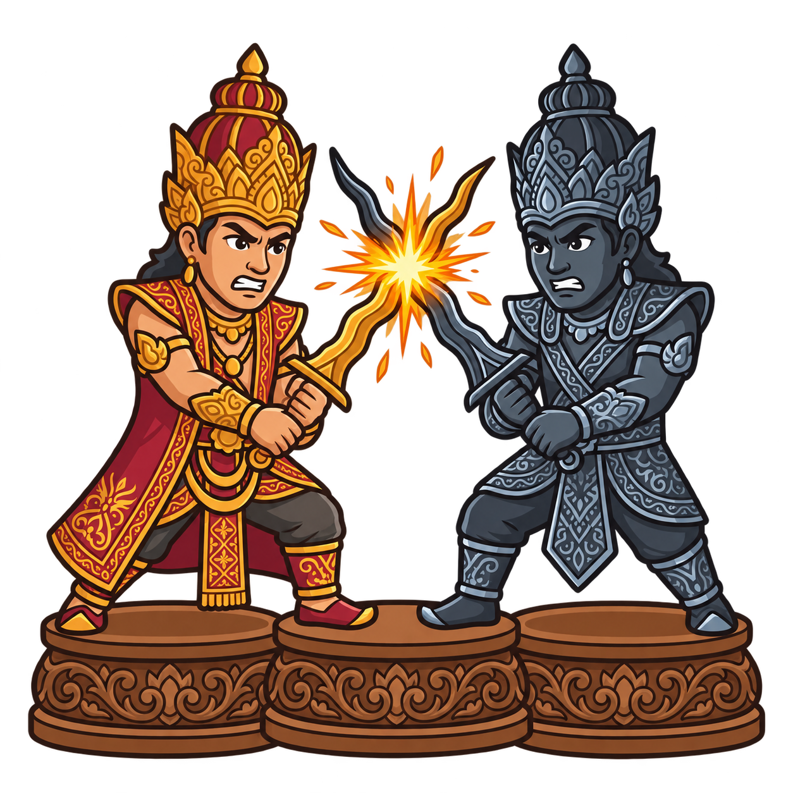

<a id="readme-top"></a>

<h1 align="center">Nusantara Chess · Takhta Delapan Petak</h1>

### Project Team / Identitas Tim

| Name / Nama | Student ID / NIM |
| --- | --- |
| Raditya Ramadhan Eka Widhianto | 245150207111054 |
| Priyambodo Arundaya Satmika | 245150201111011 |
| Alif Negifta Wibawaputra | 245150200111066 |
| Shalahuddin Al-Ayyubi Jundi Al-Islam | 245150207111066 |

<div align="center">
  <a href="https://github.com/JavaneseIvankov/nusantara-chess">
    
  </a>
  <p>
    A 3D chess game you can play offline against a bot or with a friend on the same computer.<br>
    Game catur 3D yang bisa dimainkan offline melawan bot atau bersama teman di satu komputer.
  </p>
  <p><a href="#english"><strong>English</strong></a> · <a href="#bahasa-indonesia"><strong>Bahasa Indonesia</strong></a> · <a href="https://github.com/JavaneseIvankov/nusantara-chess/issues">GitHub Issues</a></p>
</div>

[![Godot 4.7.2][godot-badge]][godot]
[![Stockfish 19][stockfish-badge]][stockfish]
![Windows and Linux x86-64][platform-badge]

<details>
<summary>Table of Contents / Daftar Isi</summary>

- **[English](#english)** · [About](#about-the-project) · [Getting Started](#getting-started) · [Usage](#usage) · [Roadmap](#roadmap) · [Contributing](#contributing) · [License](#license) · [Contact](#contact) · [Acknowledgments](#acknowledgments)
- **[Bahasa Indonesia](#bahasa-indonesia)** · [Tentang Proyek](#tentang-proyek) · [Cara Memulai](#cara-memulai) · [Cara Bermain](#cara-bermain) · [Rencana Pengembangan](#rencana-pengembangan) · [Kontribusi](#kontribusi) · [Lisensi](#lisensi) · [Kontak](#kontak) · [Apresiasi](#apresiasi)

</details>

## English

### About the Project

Nusantara Chess brings standard chess to a 3D temple courtyard with a carved board and two factions, **Emas** (Gold) and **Obsidian**. The **Takhta Senja** interface uses team illustrations, bronze accents, and a dark stone palette.

| Mode | How it works |
| --- | --- |
| **Play vs Bot** (`Lawan Bot`) | Choose Emas or Obsidian and pick Beginner (`Pemula`), Intermediate (`Menengah`), or Advanced (`Mahir`). Stockfish runs locally. |
| **Local Two Player** (`Dua Pemain Lokal`) | Two players take turns on the same computer. Emas moves first. |

The game supports castling, en passant, pawn promotion, checkmate, and stalemate. The HUD shows whose turn it is, move history, captured pieces, and a short replay after each capture.

#### Built With

- [Godot 4.7.2 Standard][godot] and GDScript for the game, 3D scenes, and interface.
- [Stockfish 19][stockfish] for the offline opponent, connected through the Universal Chess Interface (UCI).
- Asul and Source Sans 3 for the interface typography.

### Getting Started

#### Play from a Demo ZIP

Extract the entire ZIP, then run `NusantaraChess.exe` on Windows x86-64 or `NusantaraChess.x86_64` on Linux x86-64. Keep the `engine/` folder beside the executable so the game can find Stockfish. If a Linux extractor drops executable permissions, run `chmod +x NusantaraChess.x86_64 engine/stockfish` from the extracted folder.

#### Run from Source

1. Clone the repository and open `project.godot` in [Godot 4.7.2 Standard][godot]. The changes described here are on [`feat/takhta-senja-stockfish`][demo-branch].
2. For bot play, download the matching [Stockfish 19 universal x86-64 build][stockfish]. Put the binary at `engine/stockfish.exe` on Windows or `engine/stockfish` on Linux. On Linux, run `chmod +x engine/stockfish`. The local two-player mode runs without Stockfish.
3. Press **F5** in Godot to launch the game.

#### Build the Demo Packages

Install the matching Godot export templates, Python 3.11 or later, and `curl`. From the repository root, run:

```sh
python3 tools/package_release.py --godot /path/to/godot --cache /path/to/cache --output /path/to/output
```

The script checks the Stockfish archive SHA-256 hashes and produces one ZIP for Windows and one for Linux. Each ZIP contains the game, its Stockfish binary, instructions, and license notices.

### Usage

- Left-click a piece, then click a highlighted destination.
- Right-click and drag to orbit. Scroll to zoom, or select **Top View** (`Sudut Atas`) in the HUD.
- Press **Tab** to move between menu controls and **Enter** to activate a selection.

### Roadmap

- [x] Offline bot and local two-player matches.
- [x] Takhta Senja interface and portable desktop packages.
- [ ] Smoke-test the Windows package on native Windows.

The demo packages have run offline on Linux and through Wine for the Windows executable.

### Contributing

Open a [GitHub issue][issues] with steps to reproduce, your OS, and whether you used a demo ZIP or the Godot editor. For changes to the board or bot on Linux, run the gameplay smoke test:

```sh
godot --headless --path . res://tests/game_smoke.tscn
```

For interface changes, set `NUSANTARA_SCREENSHOTS` to an existing directory and run `godot --path . res://tests/visual_smoke.tscn` in a graphical session. See the [asset specifications][assets] before adding 3D models.

### License

The desktop packages include the Godot notices, Stockfish's GPLv3 license and source reference, and the SIL Open Font License notices for [Asul][asul-license] and [Source Sans 3][source-sans-license].

### Contact

Use [GitHub Issues][issues] for bugs and feature requests. The project team is listed at the top of this README.

### Acknowledgments

- The Nusantara Chess team contributed the [game illustrations][team-art].
- The README structure is adapted from [Best-README-Template][template].

[Back to top](#readme-top)

## Bahasa Indonesia

### Tentang Proyek

Nusantara Chess membawa catur standar ke pelataran candi 3D dengan papan ukir dan dua faksi, **Emas** dan **Obsidian**. Antarmuka **Takhta Senja** memakai ilustrasi tim, aksen perunggu, dan palet batu gelap.

| Mode | Cara bermain |
| --- | --- |
| **Lawan Bot** | Pilih Emas atau Obsidian, lalu pilih tingkat Pemula, Menengah, atau Mahir. Stockfish berjalan secara lokal. |
| **Dua Pemain Lokal** | Dua pemain bergantian di komputer yang sama. Emas melangkah pertama. |

Game mendukung rokade, en passant, promosi pion, skakmat, dan pat. HUD menampilkan giliran, riwayat langkah, bidak tawanan, dan cuplikan singkat setelah penangkapan.

#### Teknologi

- [Godot 4.7.2 Standard][godot] dan GDScript untuk game, adegan 3D, dan antarmuka.
- [Stockfish 19][stockfish] untuk lawan offline, terhubung melalui Universal Chess Interface (UCI).
- Asul dan Source Sans 3 untuk tipografi antarmuka.

### Cara Memulai

#### Main dari ZIP Demo

Ekstrak seluruh ZIP, lalu buka `NusantaraChess.exe` di Windows x86-64 atau jalankan `NusantaraChess.x86_64` di Linux x86-64. Biarkan folder `engine/` di samping executable agar game bisa menemukan Stockfish. Jika izin eksekusi hilang saat ekstraksi di Linux, jalankan `chmod +x NusantaraChess.x86_64 engine/stockfish` dari folder hasil ekstraksi.

#### Jalankan dari Kode Sumber

1. Clone repositori dan buka `project.godot` dengan [Godot 4.7.2 Standard][godot]. Perubahan yang didokumentasikan di sini ada di branch [`feat/takhta-senja-stockfish`][demo-branch].
2. Untuk bermain melawan bot, unduh [Stockfish 19 universal x86-64][stockfish] sesuai OS. Letakkan binarinya di `engine/stockfish.exe` untuk Windows atau `engine/stockfish` untuk Linux. Di Linux, jalankan `chmod +x engine/stockfish`. Mode Dua Pemain Lokal bisa berjalan tanpa Stockfish.
3. Tekan **F5** di Godot untuk menjalankan game.

#### Buat Paket Demo

Pasang template ekspor Godot dengan versi yang sesuai, Python 3.11 atau lebih baru, dan `curl`. Dari direktori utama repositori, jalankan:

```sh
python3 tools/package_release.py --godot /path/to/godot --cache /path/to/cache --output /path/to/output
```

Skrip memeriksa SHA-256 arsip Stockfish dan menghasilkan satu ZIP Windows serta satu ZIP Linux. Setiap ZIP berisi game, binary Stockfish, petunjuk, dan dokumen lisensi.

### Cara Bermain

- Klik kiri bidak, lalu klik petak tujuan yang ditandai.
- Klik kanan dan geser untuk memutar kamera. Gulir untuk mengatur jarak pandang, atau pilih **Sudut Atas** di HUD.
- Gunakan **Tab** untuk berpindah antar kontrol menu dan **Enter** untuk memilih.

### Rencana Pengembangan

- [x] Mode lawan bot offline dan dua pemain lokal.
- [x] Antarmuka Takhta Senja dan paket desktop siap ekstrak.
- [ ] Uji paket Windows di Windows native.

Kedua paket demo sudah dijalankan secara offline, dengan pengujian langsung di Linux dan melalui Wine untuk executable Windows.

### Kontribusi

Buka [GitHub Issue][issues] dengan langkah untuk mengulang masalah, OS yang dipakai, dan apakah game dibuka dari ZIP demo atau editor Godot. Untuk perubahan pada papan atau bot di Linux, jalankan smoke test:

```sh
godot --headless --path . res://tests/game_smoke.tscn
```

Untuk perubahan antarmuka, arahkan `NUSANTARA_SCREENSHOTS` ke folder yang sudah ada, lalu jalankan `godot --path . res://tests/visual_smoke.tscn` di sesi grafis. Baca [spesifikasi aset][assets] sebelum menambahkan model 3D.

### Lisensi

Paket desktop menyertakan dokumen lisensi Godot, lisensi GPLv3 dan rujukan kode sumber Stockfish, serta SIL Open Font License untuk [Asul][asul-license] dan [Source Sans 3][source-sans-license].

### Kontak

Gunakan [GitHub Issues][issues] untuk melaporkan masalah atau mengusulkan fitur. Identitas tim tercantum di bagian atas README.

### Apresiasi

- Tim Nusantara Chess berkontribusi pada [ilustrasi game][team-art].
- Struktur README diadaptasi dari [Best-README-Template][template].

[Kembali ke atas](#readme-top)

[godot]: https://godotengine.org/download/archive/4.7.2-stable/
[stockfish]: https://github.com/official-stockfish/Stockfish/releases/tag/sf_19
[issues]: https://github.com/JavaneseIvankov/nusantara-chess/issues
[demo-branch]: https://github.com/JavaneseIvankov/nusantara-chess/tree/feat/takhta-senja-stockfish
[assets]: ASSET_SPECIFICATIONS.md
[team-art]: assets/ui/art/
[asul-license]: assets/ui/fonts/Asul-OFL.txt
[source-sans-license]: assets/ui/fonts/SourceSans3-OFL.txt
[template]: https://github.com/othneildrew/Best-README-Template
[godot-badge]: https://img.shields.io/badge/Godot-4.7.2-478CBF?style=flat-square&logo=godotengine&logoColor=white
[stockfish-badge]: https://img.shields.io/badge/Stockfish-19-273444?style=flat-square
[platform-badge]: https://img.shields.io/badge/Desktop-Windows%20%7C%20Linux-615439?style=flat-square
